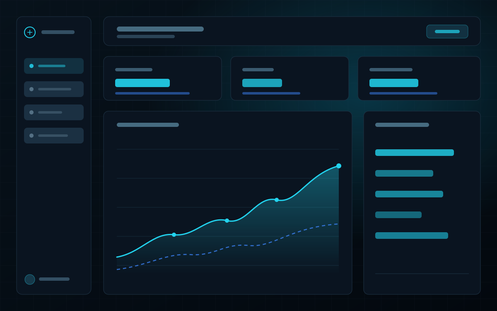

# Atlas Analytics

A React + TypeScript analytics workspace built by **SYFERON**. It turns event data into clear, shareable decisions: KPI cards, an interactive SVG event-volume chart, and segment-level reporting with workspace filters.



Atlas is the frontend half of a full-stack pair. When `VITE_API_BASE_URL` points at the [Relay API Platform](https://github.com/OlaniTech/relay-api-platform), the dashboard renders real aggregates stored in Relay's SQLite database. Without that configuration it falls back to bundled demo data, so the public GitHub Pages build works without a backend.

## Run locally

### Demo only (frontend)

```cmd
set "PATH=C:\Program Files\nodejs;%PATH%"
cd projects\atlas-analytics
npm install
npm run dev
```

Open the URL Vite prints (default `http://localhost:5173`). The badge in the header reads **DEMO DATA**.

### Full stack (Atlas + Relay)

Use two terminals.

Terminal 1 — start the Relay API:

```cmd
set "PATH=C:\Program Files\nodejs;%PATH%"
cd projects\relay-api-platform
npm install
npm run server
```

Terminal 2 — point Atlas at it:

```cmd
set "PATH=C:\Program Files\nodejs;%PATH%"
cd projects\atlas-analytics
npm install
copy /Y .env.example .env
npm run dev
```

The API listens on `http://localhost:4000`. Atlas reads `.env` at startup and the header badge should read **LIVE API**. POST new events with `curl` or the Relay console and reload Atlas to see the aggregates change:

```cmd
curl -X POST http://localhost:4000/v1/events -H "Authorization: Bearer rly_live_demo" -H "Content-Type: application/json" -H "Idempotency-Key: demo-1" -d "{\"type\":\"event.created\",\"data\":{\"source\":\"atlas\"}}"
```

## Configuration

| Variable | Default | Purpose |
| --- | --- | --- |
| `VITE_API_BASE_URL` | unset | Relay API origin, e.g. `http://localhost:4000`. Unset = bundled demo data. |
| `VITE_API_KEY` | `rly_live_demo` | Bearer token sent to Relay. Change to match `RELAY_API_KEY` on the server. |

See `.env.example`. Never commit a real key — these are local demo defaults only.

## Documentation

- [Architecture](docs/ARCHITECTURE.md) — data flow, API adapter, source states and deployment
- [Decisions & tradeoffs](docs/DECISIONS.md) — why it's built this way and what I'd change at scale

## Tests and build

```cmd
npm test
npm run build
```

Six Vitest tests cover the API client (demo fallback, live fetch, failure fallback) and the dashboard's live/demo badges. The GitHub Actions workflow runs them before building and deploying.

## Stack

React 19 · TypeScript · Vite 8 · hand-built SVG charts · REST client with graceful fallback to local data · Vitest + Testing Library.

## Part of the SYFERON portfolio

This repository is one of four projects published alongside the SYFERON site:

- Atlas Analytics — analytics workspace (frontend of the full-stack pair)
- Relay API Platform — Express + SQLite API (backend of the full-stack pair)
- Sentinel Recon Toolkit — authorized security-assessment automation
- Signal Threat Intelligence — threat-intelligence correlation dashboard

All demos carry the SYFERON watermark. They are demos, not production systems.

## License

MIT — see [LICENSE](./LICENSE).
